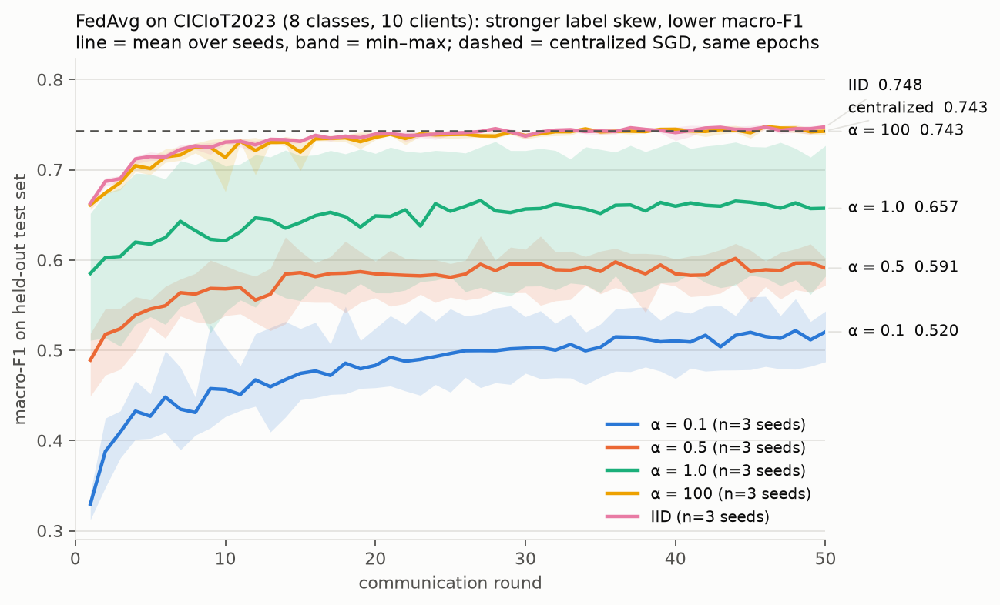

# secure-federated-ids

Federated intrusion detection for IoT networks (CICIoT2023) under model poisoning and privacy attacks.
The project compares robust aggregation rules (Median, Trimmed Mean, Krum, FLTrust, DeepSight) against
untargeted and backdoor attacks on non-IID clients, and proposes an EMA-based client reputation
that is robust to on-off attackers, with differential privacy as an additional axis.

Status: work in progress (Nov–Dec 2026). Research plan: `PLAN.md`.

## Results so far (Phase 1)

FedAvg on CICIoT2023 (8 classes, 10 clients, 50 rounds), macro-F1 on a held-out test set:
IID 0.748 · Dirichlet α=1.0 0.657 · α=0.5 0.591 · α=0.1 0.520 (centralized ceiling 0.743).
Details and sanity checks: [`notes/sanity_p1.md`](notes/sanity_p1.md).



## Reproduce

```bash
.venv/bin/python scripts/prepare_data.py            # CSV.zip -> data/processed/ciciot_8cls.npz
.venv/bin/python scripts/baselines.py --epochs 50   # majority / centralized / random forest
.venv/bin/python scripts/run_grid.py configs/fedavg_alpha.yaml --workers 8
.venv/bin/python scripts/plots.py                   # report/figures/
.venv/bin/python -m pytest -q
```

## Layout

```
data/raw/        CICIoT2023 CSVs (gitignored)
data/processed/  .npz, label_counts.csv (gitignored)
src/fl/          data, partition, model, client, server; labels.py (34 -> 8 classes)
src/attacks/ src/defenses/ src/privacy/
configs/         one YAML per experiment grid
scripts/         sanity checks, label counts, run_grid, aggregate, plots
results/         jsonl, one line per run
notes/           threat_model.md, hypotheses.md
report/
```

## Local (macOS, CPU/MPS)

```bash
python3.11 -m venv .venv
.venv/bin/pip install torch==2.15.0 -r requirements.txt
.venv/bin/python -m pytest -q
.venv/bin/python scripts/gpu_sanity.py
```

## GPU server gpu2 (venv, verified 2026-11-16)

Quadro RTX 5000 (Turing, sm_75), driver 595.45.04 / CUDA 13.2. User is not in the `docker` group,
so the venv path is used. torch 2.15.0+cu132 includes sm_75; FP16 autocast works, no BF16 on Turing.
The GPU is shared: check `nvidia-smi` before long runs. Exact versions: `requirements.lock.gpu2.txt`.

```bash
cd ~/secure-federated-ids
python3.11 -m venv .venv
.venv/bin/pip install torch==2.15.0 --index-url https://download.pytorch.org/whl/cu132
.venv/bin/pip install -r requirements.txt
.venv/bin/python scripts/gpu_sanity.py --require-cuda
```

## GPU server (Docker)

torch 2.15.0 on Linux ships CUDA builds `cu132` and `cu134` only, so check `nvidia-smi` first.
If the driver's CUDA version is lower, pass an older `TORCH_VERSION` with a matching `TORCH_CUDA`.

```bash
docker build -t btl-fl --build-arg TORCH_CUDA=cu132 .
docker run --rm --gpus all btl-fl python scripts/gpu_sanity.py --require-cuda
docker run --rm --gpus all -v "$PWD/data:/workspace/data" -v "$PWD/results:/workspace/results" btl-fl <command>
```

## Data

UNB asks for a registration form, and the file browser only works in that browser session
(scripted requests get 403), so download by hand:
https://www.unb.ca/cic/datasets/iotdataset-2023.html -> `CSV/CSV` -> save as `data/raw/CSV.zip` (1.4 GB zipped, 8.9 GB unzipped).

The zip has no label column: each of the 34 classes is a folder, `CSV/<label>/<capture>.pcap.csv`.
Scripts read the zip directly, no extraction needed.

```bash
.venv/bin/python scripts/count_labels.py   # -> data/processed/label_counts.csv; exit 2 if a group is missing
```
